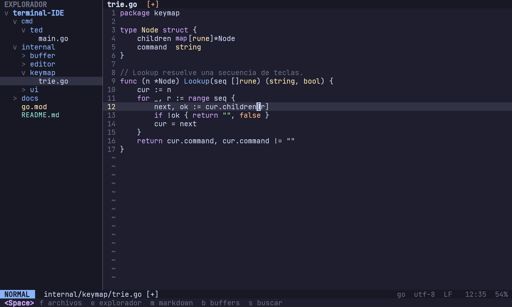
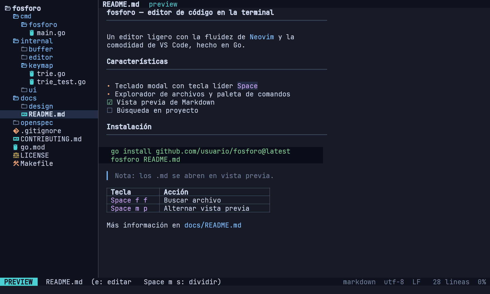
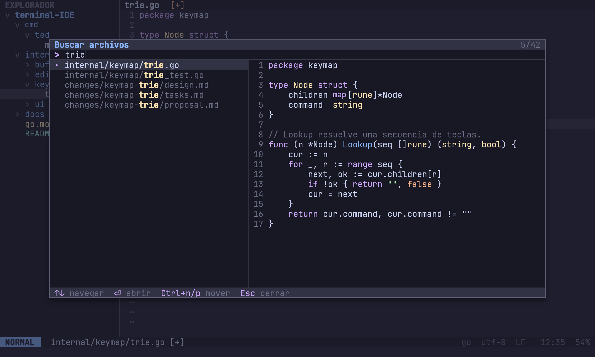
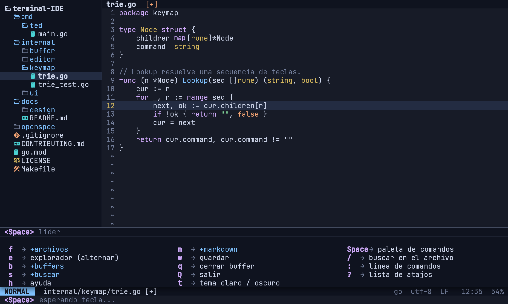
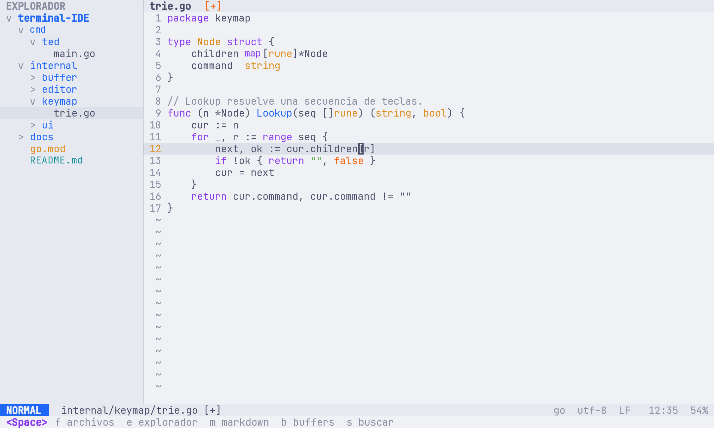

  <picture>
    <source media="(prefers-color-scheme: dark)" srcset="docs/design/brand/fosforo-logo-white.png">
    
  </picture>

<h1 align="center">fosforo</h1>

  <strong>Código que enciende ideas.</strong> 
  Un editor de código para tu terminal: rápido como Neovim, cómodo como VS Code.

  
  
  
  

> [!NOTE]
> **fosforo está empezando.** Todavía no se puede instalar: ahora mismo hay diseño, planificación y documentación.
> Aquí puedes ver qué se está construyendo y seguir el avance versión a versión.

  

## ✨ ¿Qué es fosforo?

Es un **editor de código que vive dentro de la terminal**. Lo abres, escribes, guardas y sigues con tu día, sin ventanas ni menús.

Toma lo mejor de dos mundos:

- **La comodidad de VS Code:** explorador de archivos con iconos, buscar archivos al instante, colores en el código y la vista bonita de Markdown.
- **La velocidad de Neovim:** todo se hace con el teclado, con atajos que se combinan entre sí, sin quitar las manos de las teclas.

Y si alguna vez prefieres el ratón, también funciona: hacer clic, arrastrar y usar la rueda. El teclado es el camino rápido; el ratón, un apoyo.

## 🎯 ¿Para quién es?

- Para quien **vive en la terminal** y quiere un editor moderno sin pasar horas configurando plugins.
- Para quien **viene de VS Code** y tiene curiosidad por trabajar con el teclado.
- Para quien **escribe documentación en Markdown** y quiere verla tal como se verá en GitHub.

## 🔥 Lo que traerá

| | Función | En palabras simples |
| :-: | --- | --- |
| ⌨️ | **Teclado primero** | Modos de edición como en Neovim y atajos fáciles de combinar (`3dd` borra tres líneas). |
| 🗂️ | **Explorador limpio** | Tus carpetas y archivos de un vistazo, con un icono para cada tipo de archivo. |
| 🎨 | **Colores en el código** | Cada lenguaje se ve con colores claros y suaves, en tema oscuro o claro. |
| 🔎 | **Buscar sin pensar** | Escribe unas letras y llega al archivo o al comando que quieres. |
| 🧭 | **Ayuda a la vista** | Pulsa `Space` y el propio editor te enseña qué puedes hacer a continuación. |
| 📝 | **Markdown como en GitHub** | Los `.md` se abren ya bonitos, y puedes ver el texto y el resultado lado a lado. |
| 🖱️ | **Ratón como apoyo** | Clic, arrastrar y rueda, cuando te venga mejor. |
| ⚙️ | **A tu gusto** | Cambia el tema, los atajos y los iconos con un archivo de configuración sencillo. |

## 👀 Cómo se verá

<table>
  <tr>
    <td width="50%"> <b>Markdown ya bonito</b> al abrirlo</td>
    <td width="50%"> <b>Encuentra cualquier archivo</b> escribiendo unas letras</td>
  </tr>
  <tr>
    <td width="50%"> <b>El editor te guía:</b> pulsa <code>Space</code> y verás tus opciones</td>
    <td width="50%"> <b>Tema oscuro o claro</b>, como prefieras</td>
  </tr>
</table>

## ⌨️ Atajos en 30 segundos

Con `Space` pulsado, fosforo te muestra las opciones. Estas son las más usadas:

| Teclas | Qué hace |
| --- | --- |
| `Space` `f` `f` | Buscar un archivo |
| `Space` `e` | Mostrar u ocultar el explorador |
| `Space` `Space` | Abrir la paleta de comandos |
| `Space` `m` `p` | Alternar la vista previa de Markdown |
| `i` / `Esc` | Empezar a escribir / volver a moverte |
| `:w` · `:q` | Guardar · Salir |

## 🗺️ Versiones y hoja de ruta

fosforo se publica en **versiones pequeñas y frecuentes**. Mientras el proyecto está en beta, los números empiezan por `0`.

| Versión | Estado | Qué traerá |
| :-: | :-: | --- |
| **0.0.1** | ✅ Hecha | **Fundación:** diseño, planificación, marca y documentación. |
| 0.1.0 | 🛠️ Siguiente | **Editor básico:** abrir, editar y guardar archivos. |
| 0.2.0 | ⏳ Prevista | **Edición con teclado** al estilo Neovim. |
| 0.3.0 | ⏳ Prevista | **Explorador de archivos** y varios archivos abiertos a la vez. |
| 0.4.0 | ⏳ Prevista | **Colores** en el código según el lenguaje. |
| 0.5.0 | ⏳ Prevista | **Buscador y paleta de comandos**, y el menú de ayuda de `Space`. |
| 0.6.0 | ⏳ Prevista | **Markdown como en GitHub**, con vista previa. |
| 0.7.0 | ⏳ Prevista | **Ratón:** clic, arrastrar y rueda. |
| 0.8.0 | ⏳ Prevista | **Configuración, búsqueda en el proyecto** y programa descargable. |
| 0.9.x | ⏳ Prevista | **Pulido** y corrección de errores. |
| **1.0.0** | 🎯 Meta | **Primera versión estable.** |

<b>¿Cómo se leen los números de versión?</b>

 

fosforo sigue el estándar [Versionado Semántico](https://semver.org/lang/es/): **`0.MINOR.PATCH`**.

- **`0.`** → todavía en beta: pueden cambiar cosas entre versiones.
- **El número del medio** (`0.3.0`) sube cuando llega **algo nuevo** que puedes usar.
- **El último número** (`0.3.1`) sube cuando solo se **arreglan errores**.
- **`1.0.0`** → la primera versión estable.

Cada versión se publica como *pre-release* mientras sea `0.x`, y todo lo que cambia queda anotado en el [CHANGELOG](CHANGELOG.md).

## 📦 Instalación

**Próximamente.** Cuando llegue la versión `0.1.0` podrás descargar un único programa y ejecutarlo, sin instalar nada más.

Para ver los iconos del explorador necesitarás una fuente [Nerd Font](https://www.nerdfonts.com) en tu terminal; si no la tienes, fosforo funciona igual con un modo sin iconos.

## 📚 Más información

| | |
| --- | --- |
| 🧭 [Documentación del proyecto](docs/README.md) | Visión completa, alcance, atajos y arquitectura. |
| 🎨 [Diseño visual](docs/design/README.md) | Las 12 pantallas, la marca y cómo se hizo. |
| 📋 [Cambios planificados](openspec/changes/) | Qué se construye y cómo se comprobará, versión a versión. |
| 📝 [CHANGELOG](CHANGELOG.md) | Todo lo que cambia en cada versión. |

## 🤝 Contribuir

¿Quieres ayudar? Lee la [guía para contribuir](CONTRIBUTING.md): explica en pocos pasos cómo se propone, se hace y se revisa un cambio.

## 📄 Licencia

Todavía no se ha elegido una licencia. Hasta entonces, todos los derechos están reservados.

🔥 fosforo · código que enciende ideas

